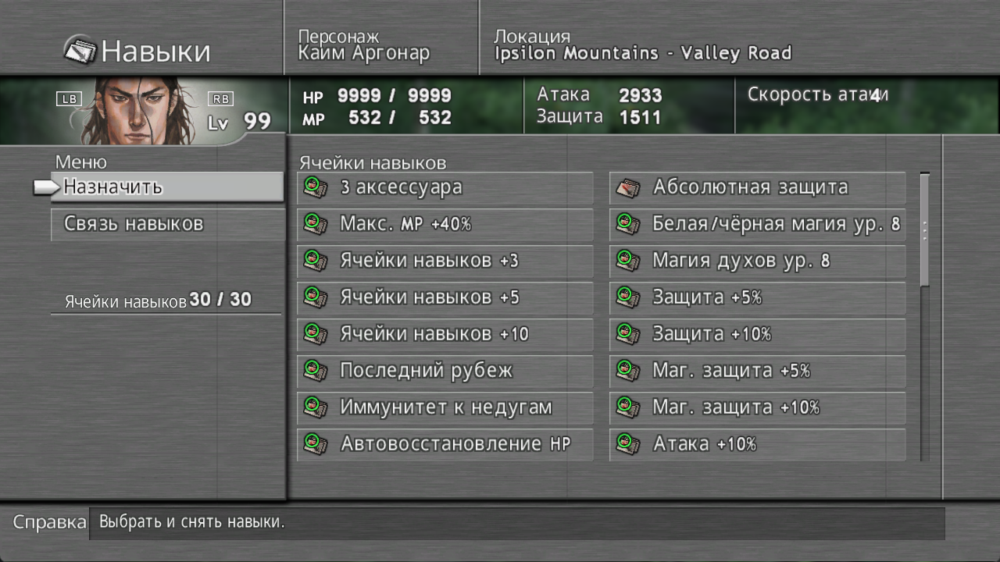
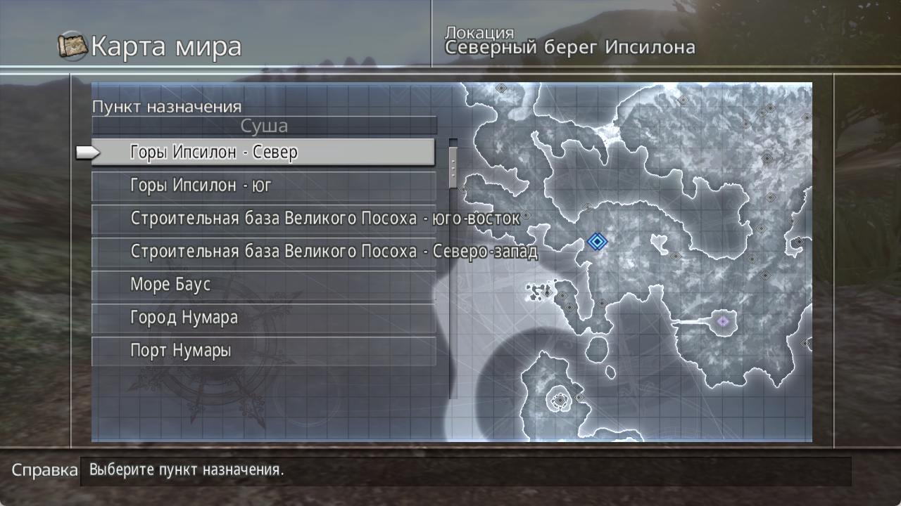
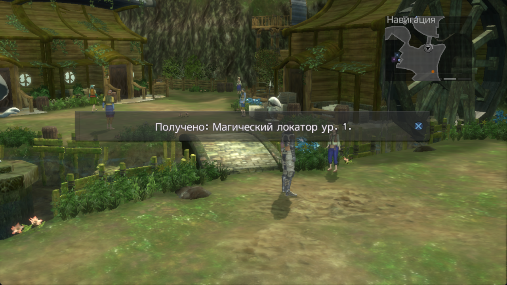
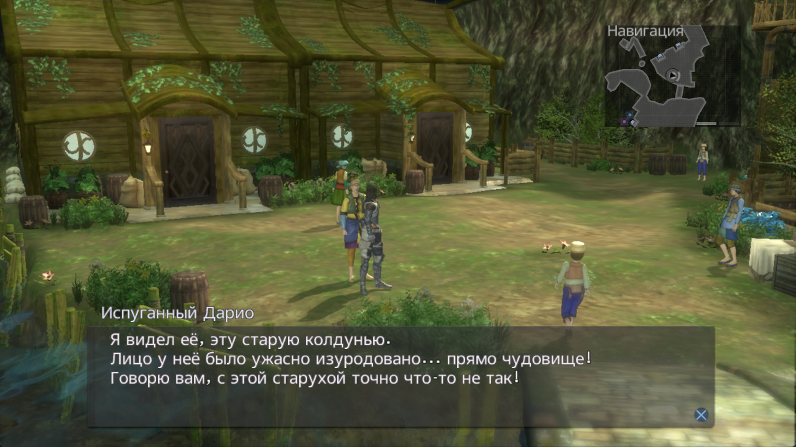

# Lost Odyssey — Russian Language Pack

**Неофициальный русский текстовый перевод для [LostOdysseyRecomp от FreeFrank](https://github.com/freefrank/LostOdysseyRecomp).**

**v0.1.0 Beta | Windows x64**

Русификатор предназначен для официального LostOdysseyRecomp от FreeFrank (Windows x64). Проверена работа на версии v1.0.4. Более новые версии могут быть совместимы, но пока не проверены. Обновления FreeFrank могут потребовать адаптации русификатора.

Диалоги, субтитры, игровые меню, предметы, навыки и боевые сообщения — на русском в поддержанных ресурсах.

Перевод незавершён. Оригинальная игра и изменённый EXE в архив не входят. Проверка в игре — выборочная; полного прохождения и проверки всех строк пока нет. **34 русских сна доступны отдельно, как экспериментальное дополнение.**

[Как установить](#как-установить) · [Что переведено](#что-переведено) · [Известные проблемы](#известные-проблемы) · [English quick start](#english-quick-start)

## Скачать / Download

**Релиз ещё не опубликован.** Ниже — точные названия файлов, которые появятся в GitHub Releases после утверждения публикации.

| Файл | Для чего |
| --- | --- |
| **`LostOdyssey-Russian-Language-Pack-v0.1.0-beta.zip`** | **Основной русификатор. Начните с него.** Работает без дополнения снов. |
| `LostOdyssey-Russian-Dreams-v0.1.0-beta-EXPERIMENTAL.zip` | Необязательно: 34 русских сна. Требует основной пакет той же версии; есть серьёзные ошибки оформления. |
| `SHA256SUMS.txt` | Контрольные суммы двух установочных архивов. |

Для установки нужен **готовый ZIP языкового пакета из Releases**. Кнопка GitHub **Code → Download ZIP** и файлы **Source code** содержат исходники проекта, а не установочный архив.

<details>
<summary>Адреса для подключения после публикации / Planned release addresses</summary>

Это запланированные адреса для рабочего имени репозитория, **не действующие ссылки скачивания**. После создания репозитория и Pre-release их нужно проверить и подключить к названиям файлов выше.

Страница релиза:

```text
https://github.com/Sanya1988/LostOdyssey-Russian-FreeFrank/releases/tag/v0.1.0-beta
```

Основной пакет:

```text
https://github.com/Sanya1988/LostOdyssey-Russian-FreeFrank/releases/download/v0.1.0-beta/LostOdyssey-Russian-Language-Pack-v0.1.0-beta.zip
```

Дополнение снов:

```text
https://github.com/Sanya1988/LostOdyssey-Russian-FreeFrank/releases/download/v0.1.0-beta/LostOdyssey-Russian-Dreams-v0.1.0-beta-EXPERIMENTAL.zip
```

Контрольные суммы:

```text
https://github.com/Sanya1988/LostOdyssey-Russian-FreeFrank/releases/download/v0.1.0-beta/SHA256SUMS.txt
```

</details>

## Скриншоты

Настоящие игровые кадры FreeFrank, предоставленные владельцем проекта. Изображения не сгенерированы; версии указаны для каждого кадра.

| Навыки — FreeFrank v1.0.4 | Карта — FreeFrank v1.0.4 |
| --- | --- |
|  |  |
| Названия с `%` отображаются. В верхней панели остаётся наложение подписи характеристики. | Названия локаций переведены частично; некоторые длинные подписи выходят за границы списка. |
| **Получение предмета — FreeFrank v1.0.4** | **Диалог — FreeFrank v1.0.0, ранняя версия** |
|  |  |
| Сообщение о получении предмета во время игры. | Кадр из предыдущего этапа; не является подтверждением работы этого диалога на v1.0.4. |

[Происхождение кадров и статус прав / Screenshot provenance and rights](docs/screenshots/README.md).

## Как установить

Установка выполняется распаковкой ZIP. Компиляция не требуется.

1. Скачайте официальный **[FreeFrank для Windows x64](https://github.com/freefrank/LostOdysseyRecomp/releases/latest)**.
2. Настройте его со своими оригинальными игровыми данными Lost Odyssey по инструкции FreeFrank. Сначала убедитесь, что игра запускается.
3. **Полностью закройте игру.** Если уже есть папка `mods/ru`, перенесите её целиком в резервное место **за пределами `mods`**. Старую и новую версии основного пакета объединять не следует.
4. После публикации нашего релиза скачайте **`LostOdyssey-Russian-Language-Pack-v0.1.0-beta.zip`** из раздела **Releases**.
5. Распакуйте архив **в папку, где находится `LostOdysseyRecomp.exe`**, сохраняя структуру каталогов.
6. Проверьте итоговый путь: **`mods/ru/language.ini`**. Не должно быть лишней папки с названием архива или пути `mods/mods/ru`.
7. Запустите FreeFrank. Откройте **Settings → System → Game language** и выберите **Russian**.
8. Нажмите **Save settings**, полностью перезапустите игру и загрузите своё сохранение.

```text
Папка FreeFrank/
├── LostOdysseyRecomp.exe
└── mods/
    └── ru/
        ├── language.ini
        ├── text/
        ├── fonts/
        └── licenses/
```

В списке язык называется **Russian**: это русский перевод с идентификатором `ru`. Латинское название обходит ограничение шрифта меню настроек FreeFrank v1.0.4.

Выбирайте именно **Game language**; пункт **Settings language** меняет язык собственного меню настроек FreeFrank. Если русского нет в списке, проверьте путь, отсутствие второго пакета с `id=ru` внутри `mods` и перезапуск.

**Подробно:** [Установка на русском](docs/INSTALL.ru.md) · [Installation in English](docs/INSTALL.en.md) · [FAQ](docs/FAQ.ru.md).

### Русские сны — необязательно

Все **34 рассказа** переведены, но вынесены в отдельный **EXPERIMENTAL** ZIP. Основной русификатор использует оригинальные тексты снов и работает самостоятельно.

Установите основной пакет, закройте игру и распакуйте **`LostOdyssey-Russian-Dreams-v0.1.0-beta-EXPERIMENTAL.zip`** в ту же папку с `LostOdysseyRecomp.exe`, объединяя `mods/ru`. Затем перезапустите игру.

**Внимание:** во снах возможны сильные наложения фрагментов, неудобные переносы, разрывы слов, нарушения анимации и оформления. Некоторые страницы трудно читать. Исправление этих проблем не заявлено.

### Как удалить

Закройте игру. Перенесите **только папку этого пакета `mods/ru`** за пределы `mods`, затем выберите другой доступный игровой язык и перезапустите FreeFrank. Если у вас была своя резервная копия `ru`, восстановите её вместо пакета.

Чтобы убрать **только экспериментальные сны**, перенесите всю текущую `mods/ru` за пределы `mods` и заново распакуйте чистый основной ZIP. Простая распаковка основного ZIP поверх дополнения не удаляет оставшиеся файлы снов.

Сохранения, достижения, другие моды и оригинальные игровые файлы для удаления перевода трогать не нужно.

## Что переведено

- Диалоги и сюжетные субтитры.
- Основные игровые меню и ряд системных сообщений.
- Предметы, описания, магия и навыки в поддержанных контекстах.
- Боевые сообщения и действия.
- Часть названий локаций и обучающие сообщения.
- Кириллические шрифты для этих текстов.

Это текстовый пакет; русская озвучка и графические замены в него не входят. Некоторые тексты остаются английскими.

<details>
<summary>Объём и границы проверки</summary>

Пакет основан на существующем переводе **RU 0.5.1**. Основной ZIP: **27 951 JSON-ключ, 536 текстовых ресурсов, 11 LOFONT**. Дополнение: **7 802 ключа в 34 ресурсах снов**; вместе — 35 753 ключа / 570 ресурсов. Число ключей не является процентом готовности или числом отдельных реплик. Девять вступительных сюжетных подписей остаются в основном пакете.

Владелец выборочно проверил на FreeFrank v1.0.4 запуск и загрузку сохранений, навыки с `%`, диалоги и субтитры, предметы, часть магии, действия, локации и примеры снов. Автоматические проверки форматов охватывают все четыре диска. Это не полное игровое прохождение и не визуальная проверка каждой строки. Другие версии и платформы требуют отдельного тестирования.

</details>

## Известные проблемы

- Экспериментальные сны имеют серьёзные ошибки расположения текста и анимации.
- Длинные строки интерфейса иногда перекрываются или выходят за границы.
- Отдельные названия магии остаются английскими из-за конфликта полных и коротких названий.
- Ограничение XMB string pool оставляет часть названий локаций без русской замены.
- Старые сохранения могут показывать ранее записанные английские названия мест.
- Стартовый экран, первоначальная настройка и часть собственного интерфейса FreeFrank ещё не переведены.
- Некоторые графические надписи в бою и Loading остаются оригинальными; графический мод не включён.

Исчезавшие названия навыков с `%` **исправлены в RU 0.5.1** и проверены владельцем на примерах. Это не обещание устранить любую возможную пустую подпись.

[Полный список проблем](docs/KNOWN_ISSUES.ru.md) · [Known issues in English](docs/KNOWN_ISSUES.en.md) · [Release Notes](RELEASE_NOTES.md).

Для сообщения об ошибке укажите версию FreeFrank и пакета, диск, локацию, экран, проблемный текст и шаги воспроизведения. После публикации используйте Issues этого проекта; пока передавайте замечания владельцу. Удаляйте личные данные из приложений. Игровые файлы, сохранения, токены и полные дампы прикладывать не нужно.

## English quick start

Unofficial Russian text translation for **[FreeFrank LostOdysseyRecomp](https://github.com/freefrank/LostOdysseyRecomp), Windows x64**. This language pack is intended for the official LostOdysseyRecomp from FreeFrank (Windows x64). It has been tested on v1.0.4. Newer versions may be compatible but have not yet been tested. FreeFrank updates may require the language pack to be adapted. Beta, selectively tested; no complete playthrough or approval of every string is claimed. No original game or modified EXE is included. **This release is not published yet.**

1. Set up official **[FreeFrank for Windows x64](https://github.com/freefrank/LostOdysseyRecomp/releases/latest)** with your own original game data. Close the game.
2. Once published, get **`LostOdyssey-Russian-Language-Pack-v0.1.0-beta.zip`** from Releases, not **Source code** or **Code → Download ZIP**.
3. Move any existing `mods/ru` completely outside `mods`. Extract the main ZIP beside `LostOdysseyRecomp.exe`, producing **`mods/ru/language.ini`**.
4. Start FreeFrank → **Settings → System → Game language → Russian → Save settings**. Fully restart, then load your save.

The separate **34-Dream EXPERIMENTAL** ZIP is optional: extract it over the same base version in the same EXE folder with the game closed. Severe overlaps, wrapping and animation issues remain. To remove it, move the entire `mods/ru` outside `mods` and install a fresh base ZIP. To uninstall the translation, leave that folder removed and select another language; keep saves, achievements, other mods and game files.

[English overview](README.en.md) · [Full English installation](docs/INSTALL.en.md) · [FAQ](docs/FAQ.en.md) · [Known issues](docs/KNOWN_ISSUES.en.md).

## Авторы, благодарности и права

**Автор русификатора: Sanya1988.** Это авторство русской редакции и языкового пакета, а не оригинальной Lost Odyssey.

**LostOdysseyRecomp:** FreeFrank и участники официального проекта порта. Спасибо за штатную систему языковых пакетов. Их авторство относится к порту; одобрение этого перевода не заявляется.

**Lost Odyssey:** оригинальная игра и её материалы принадлежат соответствующим правообладателям; Microsoft — издатель, Mistwalker и feelplus — разработчики. Этот фанатский проект не связан с ними официально.

**Шрифты:** дополнения на основе Noto Sans распространяются с уведомлением SIL OFL 1.1. Остальные права рассматриваются отдельно. Скриншоты предоставлены владельцем, но содержат охраняемые материалы игры; право их публичного размещения не считается подтверждённым.

**Публикация ожидает утверждения. Права на производный перевод и игровые изображения: LEGAL_REVIEW_REQUIRED.** Общая открытая лицензия на перевод или скриншоты не назначена. Уведомления не заменяют разрешение правообладателей.

[Права и лицензии](LICENSE.md) · [Сторонние компоненты](THIRD_PARTY_NOTICES.md) · [Происхождение скриншотов](docs/screenshots/README.md).
